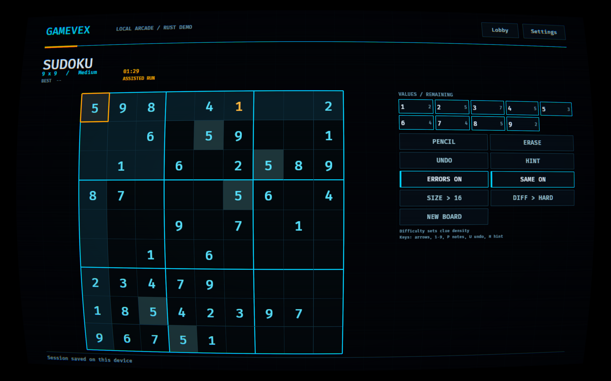
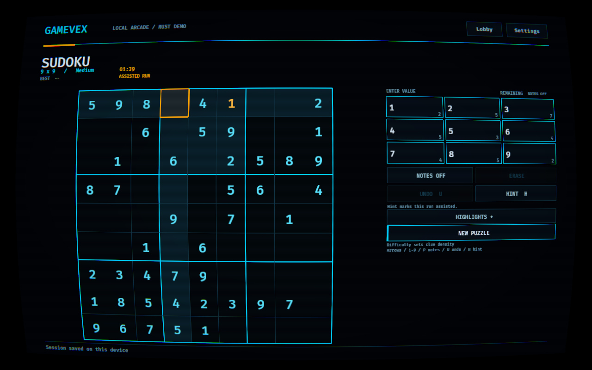
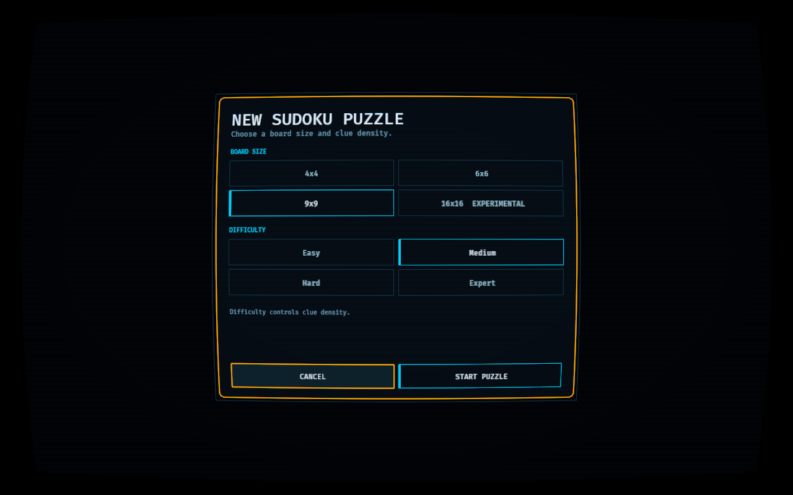

# Sudoku controls UX update

Reviewed and implemented on 30 October 2026 in `gamevex-2`. Scope: selecting values, editing notes, using assistance, and choosing a new puzzle. The CRT appearance and game rules remain intact. Current-run captures below show the same isolated 9x9 Medium puzzle at the same native window size.

1. **Value entry:** the old flat five-column bank made number placement harder to scan. The new 9x9 pad uses three rows of three, larger symbols, separate remaining counts, and selected-value/note feedback. Mouse edits return focus to the board so typing continues. Undo selects and reveals the changed cell.
2. **Editing tools:** Notes, Erase, Undo, and Hint now form a separate group. Unavailable actions look disabled and have no hit targets. Notes shows its current state; given/filled cells and unavailable hints get explanations. The saved Errors/Same preferences sit behind Highlights, reducing the default button count.
3. **New puzzle:** the old size/difficulty cycle buttons displayed the next choice, which could be mistaken for the current mode. A dedicated chooser now shows all choices with the draft selection highlighted. Start is explicit; Cancel/Escape preserves progress. Edited puzzles still require replacement confirmation. Keyboard focus starts on Cancel.

## Before

## After

## Puzzle chooser

## Verification and remaining limits

118 Rust tests, formatting, Clippy, and both release builds passed. Actual native/browser inspection and browser interaction checks covered desktop, narrow, and short layouts, editing, cancellation, timer pause, keyboard focus, and reload. The 17-case browser suite has syntax validation; it was not rerun through Playwright after this update. Detailed evidence is in [VERIFICATION.md](VERIFICATION.md#sudoku-controls-update--30-october-2026).

The controls now communicate priority, current mode, and availability more clearly. Very short windows still require board panning, especially in experimental 16x16. The canvas still lacks individual semantic controls/cells for screen readers; no touch-device or WCAG-conformance claim is made.
