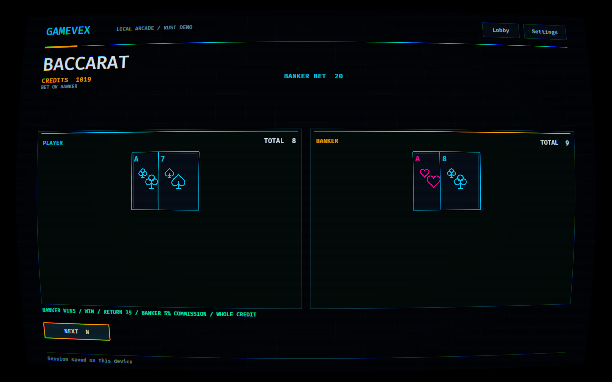
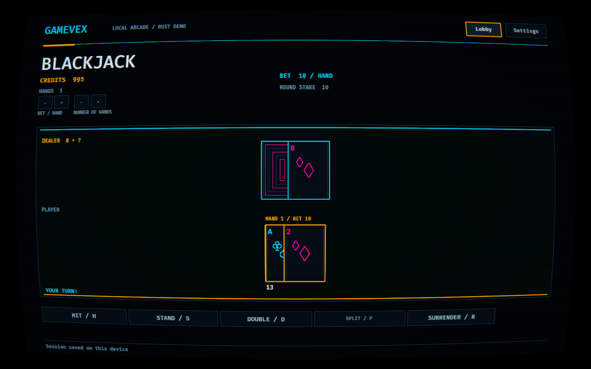
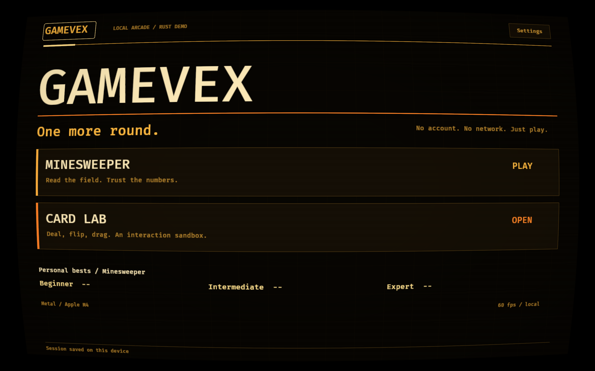
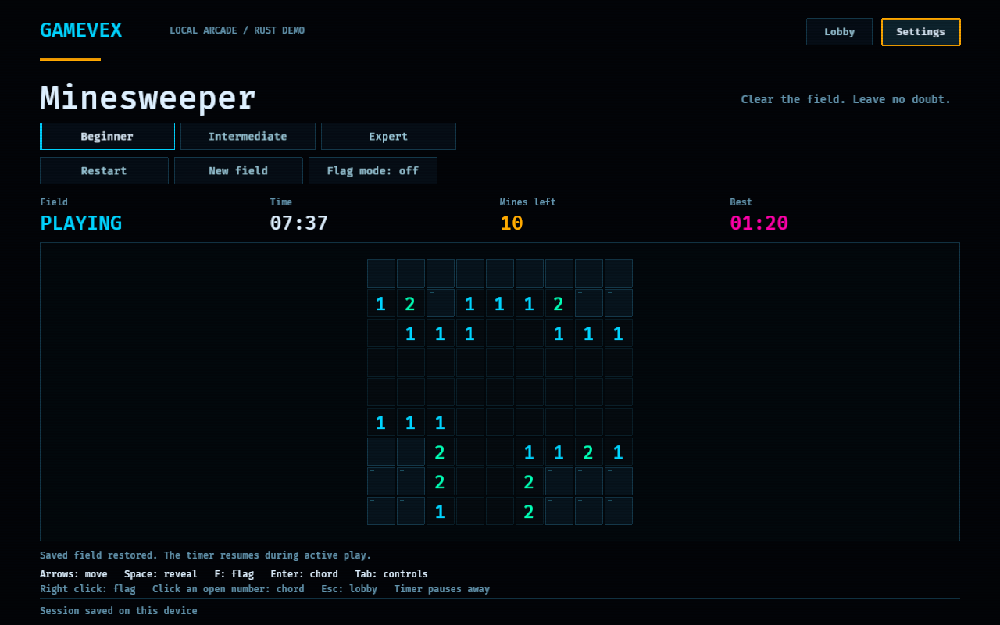

# GameVex Rust demo verification

Verified locally on 29 October 2026. Implementation and artifacts live in `gamevex-2` (Rust code in `src/`); the original GameVex repository was used only as a read-only rules/palette reference. Focused implementation and review work used Luna subagents.

## Automated checks and builds

- `cargo fmt --all -- --check`
- `cargo test --workspace --locked`: 88 tests passed (60 core, 28 application/platform).
- `cargo clippy --workspace --all-targets --locked -- -D warnings`
- Native development and release builds succeeded; `scripts/package-macos.sh` produced `target/GameVex Rust.app`.
- WASM release compilation and wasm-bindgen packaging succeeded; the generated JavaScript passed `node --check`.
- Shell scripts passed `bash -n`; the custom browser loader passed `node --check`.

Tests cover first-reveal protection over every difficulty and 32 seeds, mine/adjacency counts, flood behavior and pre-existing flags, correct/wrong-flag chording, win/loss and completed-command rejection, zero-seed determinism, save round trips and invalid-state checks, bounded elapsed time, record improvement, repeatable cards, valid/invalid/occupied drops, drag cancellation, native atomic file replacement, board picking with a clipped/panned viewport, modal focus restoration, timer transition/fractional-millisecond accounting, curved-monitor input mapping, old-save defaults for the added settings, and complete saved-data reset.

Dependencies are locked in `Cargo.lock`: Bevy 0.17.3, serde 1.0.228, serde_json 1.0.145, wasm-bindgen 0.2.129, and web-sys 0.3.106. The machine uses Homebrew Rust/Cargo 1.99.1. Because that distribution lacked a WASM target library and linker, the browser build used its installed Rust sources through `build-std`, plus an official Rust LLD extracted into `/private/tmp` and a matching temporary wasm-bindgen CLI. No global Rust toolchain was replaced. The regular rustup-target path is also documented in the README.

The transitive macOS dependency `block 0.1.6` emits Cargo's future-incompatibility notice. Workspace Clippy itself has no warnings.

## Actual runtime checks

| Check | Native macOS | Browser WebGPU |
| --- | --- | --- |
| Shared lobby, Minesweeper, Card Lab, settings render | Exercised | Exercised |
| Actual backend | Metal / Apple M4 | BrowserWebGpu; browser withheld adapter name |
| First reveal and flood | Exercised | Exercised |
| Complete a game and update a record | Exercised | Exercised |
| Mine-hit loss | Exercised | Exercised |
| Secondary-click flag / successful and wrong-flag chord | Exercised | Exercised through board input; wrong-flag chord lost and retained the earlier correct flag on reload |
| Keyboard cell focus, reveal/flag, toolbar/dialog navigation | Exercised | Exercised |
| Save and restore | Process restarted; active field/time/record/settings restored | Reload/navigation restored board, flag, time, record and preset |
| Timer outside the game | Exercised through screen/focus changes | Settings pause: exactly 30,232 ms before and after an extended pause |
| Card selection / flip / keyboard slots | Exercised | Exercised |
| Pointer valid / occupied-slot drops and snapback | Native automation drag gesture did not reliably deliver motion; not claimed | Exercised, including card stacking and flip after invalid drop |
| Resize / narrow Expert board | Resizable native window rendered at 2× DPI | 390×844 CSS pixels; 32-pixel cells, clipped viewport, keyboard pan to column 30 and flag confirmed in state |
| Display presets | Vector CRT and Pixel CRT exercised | Preset persisted; geometry uses reduced resolution, text remains readable |
| Corrupt save recovery | Validation and file operations tested headlessly | Isolated invalid JSON preserved until explicit Settings reset; modal confirmed by keyboard |
| Storage failure | Error paths exist; actual native permission denial not exercised | Injected adapter failure kept the field playable with a persistent in-memory warning |

Browser fault tests use the documented isolated `gamevex.rust-demo.qa.v1` namespace. The unavailable-storage case is deliberate adapter fault injection, not a claim that browser permissions or quota were denied. Runtime inspection uses opt-in DOM diagnostics; it does not alter the authoritative game model.

## Measured performance before the monitor update

These measurements predate the curved geometry/text composite and adjustable vignette. They are retained as historical baseline measurements; the new pipeline has not been re-profiled.

Hardware: MacBook Air, Apple M4 with 10 CPU / 10 GPU cores, 16 GB RAM. Native backend: Metal, actual adapter `Apple M4`. All samples use a 1280×800 logical window and 300 foreground gameplay frame intervals. The earlier development run reported 2× DPI (2560×1600 backing pixels); the final release run reported 1× DPI (1280×800 backing pixels). Bloom was 0.35, bypassed with CRT off. These are short frame-interval samples, not GPU-only timings or a sustained soak.

| Build / DPI | CRT | Mean interval | p95 interval | Mean FPS |
| --- | --- | --- | --- | --- |
| Development / 2× | Enabled | 16.67 ms | 18.28 ms | 60.0 |
| Development / 2× | Disabled | 16.66 ms | 20.10 ms | 60.0 |
| Initial release / 1× | Disabled | 16.67 ms | 19.27 ms | 60.0 |
| Initial release / 1×, after build finished | Enabled | 16.67 ms | 29.86 ms | 60.0 |
| Initial release / 1×, WASM compiler active | Enabled | 20.56 ms | 54.61 ms | 48.6 |

Unloaded samples reached the 60-FPS mean target on this machine. The compiler-load sample and p95 values show frame jitter; these measurements do not establish a sustained frame-time guarantee or isolate the effects' GPU cost. Browser lobby/gameplay displayed approximately 60 FPS; no equivalent browser frame-profile or cross-hardware benchmark is claimed. The initial packaged native release was launched successfully on Metal.

## Browser startup and payload

The startup timings below predate the monitor update. Payload sizes are refreshed for the latest package.

The loader visibly checks WebGPU support, imports the module, and shows initialization errors. Local warm-cache initialization-to-canvas-ready markers measured **698.1 ms** and **644.0 ms** on two observed runs. This marker is emitted before first-pixel completion and is not a cold-start, network, or time-to-interactive guarantee. The local Python server sent an uncompressed WASM body; compressed file sizes are measured separately below. Embedded font/shader data are included in WASM; there are no required external media assets.

Final payload sizes are recorded in `build-sizes.json` after the last package build.

| File | Raw bytes | Gzip level 9 bytes |
| --- | ---: | ---: |
| WASM | 37,907,639 | 6,159,338 |
| Generated JavaScript | 107,369 | 17,327 |

 Gzip uses level 9 with deterministic headers. The development server does not negotiate those compressed files automatically.

## Monitor and settings update

The native Metal runtime rendered the curved screen and vignette with both cyan and amber palettes. Settings palette selection persisted to an isolated native save. Pointer activation of the curved Settings button and GameVex logo worked; the logo returned to the lobby. Reset opened a confirmation, Cancel preserved amber, and confirmation restored cyan/default settings, a ready board, and empty records. Only the temporary QA save was reset.

Chrome/WebGPU rendered the final composite and restored amber after reload. Pixel CRT retained sharp text while its geometry used the reduced resolution. Curvature and vignette steppers updated their saved strengths, and disabling CRT removed the curve and edge darkening. Curved-board secondary click flagged cell 0 and primary click revealed cell 10; the header logo returned to the lobby. At 390×650, the settings list scrolled to Volume/Sound while Reset saved data remained visible. The confirmation dialog fit the narrow viewport and Escape cancelled it. The temporary viewport override was removed after checking.

## Chromatic aberration update

Added radial red/blue channel separation to both geometry and high-resolution text. The saved 0–100% setting defaults to 35%; existing version-1 saves receive that default. Zero strength or disabling CRT bypasses the extra samples. Strength uses logical pixels consistently across display density and both presets.

All 28 tests and Clippy passed after this update. Save validation covers the added field, old-save defaults, round trips, out-of-range strengths, NaN, and infinity. The native Metal release rendered the effect, its strength control saved correctly, and CRT-off removed the color fringes. Chrome/WebGPU rendered the effect in Pixel CRT, loaded the default from an older save, disabled separation at zero strength while keeping the screen curve, and restored a changed strength after reload. At 390×650 the full setting label and controls fit without overlap; the viewport override was removed after checking.

## Web interaction repairs — 29 October 2026

Reviewed the supplied 18.5-second recording and reproduced Card Lab interaction in the browser. Fixed hover self-invalidation at the lifted bottom edge, mismatched hover/painter order, and rank labels showing through covering cards. Hover, pointer picking, and browser secondary-click regions now share bounds that retain the resting footprint without extending below it. Right-click selects and flips the targeted card, with browser menu suppression scoped to cards and the Minesweeper board.

Pointer input now consumes the ordered Bevy window-event stream. Fast clicks keep their own cursor positions; a complete drag/release can commit in a single update. Screen/modal/size guards prevent stale hit regions from receiving actions, and resizing cancels dragging. Pointer wheel input disables keyboard camera following so Expert panning stays where it was scrolled. Shared draw buffers now update in Update, before Bevy's text layout and transform propagation, instead of the unordered PostUpdate stage.

All 36 tests, formatting, Clippy, native packaging, and the WASM release build passed. New tests cover queued clicks at distinct cells, a queued down/move/up drag, topmost-card secondary flip, stale-screen navigation, resize cancellation, stable hover bounds, and label occlusion.

Actual browser checks: fast selection; secondary flip with no image menu; valid slot drops; occupied-slot snapback; desktop resize to 390×844; Expert horizontal pan remaining at the right edge; secondary clicks flagging cells 0 and 19 before/after panning; first reveal at cell 50. Native Metal also launched and exercised the shared card selection/flip path. The final browser pass used the in-app WebGPU browser on a fresh localhost origin after an earlier external Chromium session disconnected. No native drag-gesture reliability or new frame-time measurement is claimed.

Old original-app service workers were observed serving cached GameVex pages on reused preview ports. The Rust server now defaults to a separate port, 18435; original-app caches and saved data were left intact. The final playable preview is http://localhost:18435/.

## Repository layout — 29 October 2026

Moved Cargo configuration, lockfile, README, docs, scripts, web files, assets, and build outputs to the repository root. `src/` contains only Rust files; the core crate manifest points to `src/core/lib.rs`, and the app is the root package. The CRT shader is embedded from `assets/crt.wgsl` using a stable internal asset handle. Formatting, all 36 tests, Clippy, native packaging, and the WASM release build passed from the root. Both actual runtimes rendered the relocated shader successfully, and the root-level server script served the browser preview.

## Blackjack and porting foundation — 29 October 2026

Added a deterministic serializable 52-card shoe, a Bevy-independent Blackjack engine, and a lobby cabinet with one to five hands. Fixed-shoe tests exercise dealer draw order and soft-17 behavior, natural and combined odd-credit payouts, pushes, split eligibility, doubling, surrender refunds, insurance, insufficient credits, bankruptcy/restart, round abandonment, illegal commands, bounded shoe refills, and save validation. Settlement examples were compared with the original TypeScript helpers using Bun in the read-only original checkout. No original game files or saves were changed.

Save schema 2 separates Minesweeper and Blackjack under shared settings. Migration tests preserve version-1 settings, board, elapsed time, and records, while initializing Blackjack. An actual existing browser QA save migrated with its Expert board and flags intact. Active and settled Blackjack rounds restore the exact serialized shoe, hands, active index, wagers, and bankroll. Reset clears both cabinets. Card Lab remains transient.

The presentation is split into shared primitives and cabinet modules. Browser diagnostics publish interaction state and logical control bounds only when requested. Six Playwright specifications and a two-job GitHub Actions workflow were added. Local dependency installation, JavaScript syntax checks, and discovery of all six specs passed. The Playwright runner itself and hosted CI have not been executed; their headless software-WebGPU path remains unverified.

Actual in-app browser/WebGPU checks covered keyboard Deal, Double into a bust, Next round, five-hand play, sequential Stand, dealer draw and mixed push/loss settlement, active-round reload, settled-round reload, and exact state equality after restoration. A settings visit preserved the live round; cancelling the leave dialog preserved it; confirming the dialog forfeited all committed hands while retaining unspent credits. Desktop, 390×844, and 1000×560 layouts were inspected; the temporary viewport override was reset. The existing Minesweeper QA board remained independent of Blackjack play.

The packaged native app launched on Metal / Apple M4. Native keyboard Deal and Stand resolved a 16-versus-17 loss and persisted the resulting 990-credit balance to an isolated temporary save. The final native package also exercised five-hand betting, insurance purchase, and sequential Stand settlement. The original five-hand capture was replaced by the native animation-update view below. All 64 Rust tests, formatting, and warning-free workspace Clippy passed. Native release packaging and the WebAssembly release build succeeded. No new performance claim is made for this milestone.

## Blackjack animation update — 29 October 2026

Added staggered initial dealing, sliding drawn/split cards, a dealer hole-card flip, sequential dealer draws, and a brief active-hand highlight. Existing cards remain stationary when drawing. Presentation delays terminal labels and payouts until the visual sequence completes; the authoritative rules state persists immediately. Rapid game commands are ignored during animation, while settings and leave navigation remain available. Reduced motion bypasses all animation, and foreground/settings/modal handling pauses presentation timing.

The dealer label always includes a sum, including zero before a deal. While the hole card is face down it displays the face-up-card sum plus `?`; after the flip it includes all revealed cards. Aces use the same soft-total rules as gameplay. New tests cover staggered card visibility, stationary existing cards, natural-deal ordering, committed stakes versus delayed payouts, the flip midpoint, hidden-card totals, exact final state, reduced motion, and rejection of input during an animation. All 71 Rust tests and workspace Clippy pass. A regression test also checks that finishing an animation preserves keyboard focus while control hit regions rebuild.

Native Metal rendered the new dealer label with `8 + ?` while the hole card remained face down. Browser WebGPU showed staggered dealing with one dealer card and no player cards initially, then complete hands, and changed the dealer sum from the up-card total to the revealed total. Enter correctly reached Next round after settlement. A browser settings check enabled reduced motion, confirmed an immediate Hit with no active animation, then restored animations in the isolated QA save. The final 1280×720 browser view keeps cards, values, and controls separated; the 390×844 view retains the dealer sum and full hand ledger. The temporary viewport override was reset. Both release targets rebuilt successfully. No hosted CI or Playwright-runner execution is claimed.

## Baccarat port — 29 October 2026

Added a fourth lobby cabinet with separate bankroll, Player/Banker/Tie selection, wager steppers and MAX, automatic natural/tableau resolution, staged card dealing, both visible totals, result/return labels, Next round, and fixed 1,000-credit bankruptcy restart. The original TypeScript component remains a read-only behavior reference. Rules consume cards as P1/P2/B1/B2 and the presentation reveals them as P1/B1/P2/B2, followed by any third cards. Bets deduct immediately; visual payouts wait for the animation while the completed rules state persists immediately.

The core is checked against 18 value examples and all 110 Banker tableau decisions generated directly from the original TypeScript utility through Bun. The fixture file records the source SHA-256. Fixed-shoe tests cover natural 8/9, Ace=1 and modulo totals, third-card paths, Player/Banker/Tie returns, tie pushes, integer commission rounding, low-bankroll MAX, bankruptcy, exact replay/restore, invalid tables, bounded shoes, and atomic failure on insufficient fixture cards. Motion and app tests cover reveal order, reduced motion, staged credits, guarded rapid actions, settings/leave behavior, and reset. Schema-3 migration preserves complete version-2 Blackjack and Minesweeper states while adding Baccarat; version-1 migration remains supported. All 88 Rust tests, formatting, and workspace Clippy pass.

Actual browser WebGPU checks migrated the existing isolated version-2 save to version 3 with Expert first-reveal cell 50 and Blackjack's 800-credit balance intact. Banker bet 10 resolved Player 6 against Banker 5, losing the stake to 990. Reload restored the exact serialized Baccarat round and shoe; Next cleared both hands/selection and preserved credits. A Tie bet 20 then resolved Player A/K/4 = 5 against Banker 3/A/K = 4, leaving 970. The initial staggered frame exposed one Player card and no Banker cards. Desktop 1280×720, narrow 390×844, and short 1000×560 layouts were inspected, including all four lobby entries.

The native Metal / Apple M4 package ran an isolated fixed-shoe natural fixture: Player A+7 = 8, Banker A+8 = 9, Banker stake 20 returned 39 after commission and saved balance 1,019. The screenshot below is an actual native capture. Both release builds succeeded. Seven Playwright specs are discoverable and their JavaScript syntax checks pass; the Playwright runner and hosted CI remain unexecuted. No additional performance claim is made.

## Screenshots

Actual native render captures, excluding window chrome.

 The interaction repair capture shows the shared Card Lab after a secondary flip:

Earlier captures follow. The first shows chromatic aberration at its default 35%; the next two show the earlier monitor update, followed by the initial demo:

## Limits of this verification

No physical trackpad gesture, audible playback judgment, screen-reader audit, Safari/Firefox run, unavailable-WebGPU browser, long-duration soak, touch-only device, signed/notarized distribution, or other native operating system was verified. Browser focus/visibility handling is implemented with lifecycle snapshots and transition epochs, and clock behavior is tested headlessly; abrupt OS/process termination can still lose data since the last successful write. Card Lab focus loss cancels dragging in the model; resizing midway through a held native drag was not verified by the available automation. The canvas does not provide a full semantic accessibility tree for its virtual controls or board cells.
