# GameVex Rust demo verification

Verified locally on 29–30 October 2026. Implementation and artifacts live in `gamevex-2` (Rust code in `src/`); the original GameVex repository was used only as a read-only rules/palette reference. Focused implementation and review work used Luna subagents.

## Automated checks and builds

- `cargo fmt --all -- --check`
- `cargo test --workspace --locked`: 182 tests passed (106 core, 76 application/platform).
- `cargo clippy --workspace --all-targets --locked -- -D warnings`
- Native development and release builds succeeded; `scripts/package-macos.sh` produced `target/GameVex Rust.app`.
- WASM release compilation and wasm-bindgen packaging succeeded; the generated JavaScript passed `node --check`.
- Shell scripts passed `bash -n`; the custom browser loader passed `node --check`.
- The current 52-spec browser suite passed locally with the macOS/Metal override described below. Hosted Linux/SwiftShader failures are described in the CI repair sections below; local browser results do not establish physical-phone or other-browser compatibility.

Tests cover first-reveal protection over every difficulty and 32 seeds, mine/adjacency counts, flood behavior and pre-existing flags, correct/wrong-flag chording, win/loss and completed-command rejection, zero-seed determinism, save round trips and invalid-state checks, bounded elapsed time, record improvement, repeatable cards, valid/invalid/occupied drops, drag cancellation, native atomic file replacement, board picking with a clipped/panned viewport, modal focus restoration, timer transition/fractional-millisecond accounting, curved-monitor input mapping, old-save defaults for the added settings, and complete saved-data reset.

Dependencies are locked in `Cargo.lock`: Bevy 0.17.3, serde 1.0.228, serde_json 1.0.145, wasm-bindgen 0.2.129, and web-sys 0.3.106. The machine uses Homebrew Rust/Cargo 1.99.1. Because that distribution lacked a WASM target library and linker, the browser build used its installed Rust sources through `build-std`, plus an official Rust LLD extracted into `/private/tmp` and a matching temporary wasm-bindgen CLI. No global Rust toolchain was replaced. The regular rustup-target path is also documented in the README.

The transitive macOS dependency `block 0.1.6` emits Cargo's future-incompatibility notice. Workspace Clippy itself has no warnings.

## Actual runtime checks

| Check | Native macOS | Browser WebGPU |
| --- | --- | --- |
| Shared lobby, Minesweeper, Card Lab, settings render | Exercised | Exercised |
| Actual backend | Metal / Apple M4 | BrowserWebGpu; browser withheld adapter name |
| First reveal and flood | Exercised | Exercised |
| Complete a game and update a record | Exercised | Exercised |
| Mine-hit loss | Exercised | Exercised |
| Secondary-click flag / successful and wrong-flag chord | Exercised | Exercised through board input; wrong-flag chord lost and retained the earlier correct flag on reload |
| Keyboard cell focus, reveal/flag, toolbar/dialog navigation | Exercised | Exercised |
| Save and restore | Process restarted; active field/time/record/settings restored | Reload/navigation restored board, flag, time, record and preset |
| Timer outside the game | Exercised through screen/focus changes | Settings pause: exactly 30,232 ms before and after an extended pause |
| Card selection / flip / keyboard slots | Exercised | Exercised |
| Pointer valid / occupied-slot drops and snapback | Native automation drag gesture did not reliably deliver motion; not claimed | Exercised, including card stacking and flip after invalid drop |
| Resize / narrow Expert board | Resizable native window rendered at 2× DPI | 390×844 CSS pixels; 32-pixel cells, clipped viewport, keyboard pan to column 30 and flag confirmed in state |
| Display presets | Vector CRT and Pixel CRT exercised | Preset persisted; geometry uses reduced resolution, text remains readable |
| Corrupt save recovery | Validation and file operations tested headlessly | Isolated invalid JSON preserved until explicit Settings reset; modal confirmed by keyboard |
| Storage failure | Error paths exist; actual native permission denial not exercised | Injected adapter failure kept the field playable with a persistent in-memory warning |

Browser fault tests use the documented isolated `gamevex.rust-demo.qa.v1` namespace. The unavailable-storage case is deliberate adapter fault injection, not a claim that browser permissions or quota were denied. Runtime inspection uses opt-in DOM diagnostics; it does not alter the authoritative game model.

## Measured performance before the monitor update

These measurements predate the curved geometry/text composite and adjustable vignette. They are retained as historical baseline measurements; the new pipeline has not been re-profiled.

Hardware: MacBook Air, Apple M4 with 10 CPU / 10 GPU cores, 16 GB RAM. Native backend: Metal, actual adapter `Apple M4`. All samples use a 1280×800 logical window and 300 foreground gameplay frame intervals. The earlier development run reported 2× DPI (2560×1600 backing pixels); the final release run reported 1× DPI (1280×800 backing pixels). Bloom was 0.35, bypassed with CRT off. These are short frame-interval samples, not GPU-only timings or a sustained soak.

| Build / DPI | CRT | Mean interval | p95 interval | Mean FPS |
| --- | --- | --- | --- | --- |
| Development / 2× | Enabled | 16.67 ms | 18.28 ms | 60.0 |
| Development / 2× | Disabled | 16.66 ms | 20.10 ms | 60.0 |
| Initial release / 1× | Disabled | 16.67 ms | 19.27 ms | 60.0 |
| Initial release / 1×, after build finished | Enabled | 16.67 ms | 29.86 ms | 60.0 |
| Initial release / 1×, WASM compiler active | Enabled | 20.56 ms | 54.61 ms | 48.6 |

Unloaded samples reached the 60-FPS mean target on this machine. The compiler-load sample and p95 values show frame jitter; these measurements do not establish a sustained frame-time guarantee or isolate the effects' GPU cost. Browser lobby/gameplay displayed approximately 60 FPS; no equivalent browser frame-profile or cross-hardware benchmark is claimed. The initial packaged native release was launched successfully on Metal.

## Browser startup and payload

The startup timings below predate the monitor update. Payload sizes are refreshed for the latest package.

The loader visibly checks WebGPU support, imports the module, and shows initialization errors. Local warm-cache initialization-to-canvas-ready markers measured **698.1 ms** and **644.0 ms** on two observed runs. This marker is emitted before first-pixel completion and is not a cold-start, network, or time-to-interactive guarantee. The local Python server sent an uncompressed WASM body; compressed file sizes are measured separately below. Embedded font/shader data are included in WASM; there are no required external media assets.

Final payload sizes are recorded in `build-sizes.json` after the last package build.

| File | Raw bytes | Gzip level 9 bytes |
| --- | ---: | ---: |
| WASM | 38,320,468 | 6,280,561 |
| Generated JavaScript | 108,170 | 17,527 |

 Gzip uses level 9 with deterministic headers. The development server does not negotiate those compressed files automatically.

## Monitor and settings update

The native Metal runtime rendered the curved screen and vignette with both cyan and amber palettes. Settings palette selection persisted to an isolated native save. Pointer activation of the curved Settings button and GameVex logo worked; the logo returned to the lobby. Reset opened a confirmation, Cancel preserved amber, and confirmation restored cyan/default settings, a ready board, and empty records. Only the temporary QA save was reset.

Chrome/WebGPU rendered the final composite and restored amber after reload. Pixel CRT retained sharp text while its geometry used the reduced resolution. Curvature and vignette steppers updated their saved strengths, and disabling CRT removed the curve and edge darkening. Curved-board secondary click flagged cell 0 and primary click revealed cell 10; the header logo returned to the lobby. At 390×650, the settings list scrolled to Volume/Sound while Reset saved data remained visible. The confirmation dialog fit the narrow viewport and Escape cancelled it. The temporary viewport override was removed after checking.

## Chromatic aberration update

Added radial red/blue channel separation to both geometry and high-resolution text. The saved 0–100% setting defaults to 35%; existing version-1 saves receive that default. Zero strength or disabling CRT bypasses the extra samples. Strength uses logical pixels consistently across display density and both presets.

All 28 tests and Clippy passed after this update. Save validation covers the added field, old-save defaults, round trips, out-of-range strengths, NaN, and infinity. The native Metal release rendered the effect, its strength control saved correctly, and CRT-off removed the color fringes. Chrome/WebGPU rendered the effect in Pixel CRT, loaded the default from an older save, disabled separation at zero strength while keeping the screen curve, and restored a changed strength after reload. At 390×650 the full setting label and controls fit without overlap; the viewport override was removed after checking.

## Web interaction repairs — 29 October 2026

Reviewed the supplied 18.5-second recording and reproduced Card Lab interaction in the browser. Fixed hover self-invalidation at the lifted bottom edge, mismatched hover/painter order, and rank labels showing through covering cards. Hover, pointer picking, and browser secondary-click regions now share bounds that retain the resting footprint without extending below it. Right-click selects and flips the targeted card, with browser menu suppression scoped to cards and the Minesweeper board.

Pointer input now consumes the ordered Bevy window-event stream. Fast clicks keep their own cursor positions; a complete drag/release can commit in a single update. Screen/modal/size guards prevent stale hit regions from receiving actions, and resizing cancels dragging. Pointer wheel input disables keyboard camera following so Expert panning stays where it was scrolled. Shared draw buffers now update in Update, before Bevy's text layout and transform propagation, instead of the unordered PostUpdate stage.

All 36 tests, formatting, Clippy, native packaging, and the WASM release build passed. New tests cover queued clicks at distinct cells, a queued down/move/up drag, topmost-card secondary flip, stale-screen navigation, resize cancellation, stable hover bounds, and label occlusion.

Actual browser checks: fast selection; secondary flip with no image menu; valid slot drops; occupied-slot snapback; desktop resize to 390×844; Expert horizontal pan remaining at the right edge; secondary clicks flagging cells 0 and 19 before/after panning; first reveal at cell 50. Native Metal also launched and exercised the shared card selection/flip path. The final browser pass used the in-app WebGPU browser on a fresh localhost origin after an earlier external Chromium session disconnected. No native drag-gesture reliability or new frame-time measurement is claimed.

Old original-app service workers were observed serving cached GameVex pages on reused preview ports. The Rust server now defaults to a separate port, 18435; original-app caches and saved data were left intact. The final playable preview is http://localhost:18435/.

## Repository layout — 29 October 2026

Moved Cargo configuration, lockfile, README, docs, scripts, web files, assets, and build outputs to the repository root. `src/` contains only Rust files; the core crate manifest points to `src/core/lib.rs`, and the app is the root package. The CRT shader is embedded from `assets/crt.wgsl` using a stable internal asset handle. Formatting, all 36 tests, Clippy, native packaging, and the WASM release build passed from the root. Both actual runtimes rendered the relocated shader successfully, and the root-level server script served the browser preview.

## Blackjack and porting foundation — 29 October 2026

Added a deterministic serializable 52-card shoe, a Bevy-independent Blackjack engine, and a lobby cabinet with one to five hands. Fixed-shoe tests exercise dealer draw order and soft-17 behavior, natural and combined odd-credit payouts, pushes, split eligibility, doubling, surrender refunds, insurance, insufficient credits, bankruptcy/restart, round abandonment, illegal commands, bounded shoe refills, and save validation. Settlement examples were compared with the original TypeScript helpers using Bun in the read-only original checkout. No original game files or saves were changed.

Save schema 2 separates Minesweeper and Blackjack under shared settings. Migration tests preserve version-1 settings, board, elapsed time, and records, while initializing Blackjack. An actual existing browser QA save migrated with its Expert board and flags intact. Active and settled Blackjack rounds restore the exact serialized shoe, hands, active index, wagers, and bankroll. Reset clears both cabinets. Card Lab remains transient.

The presentation is split into shared primitives and cabinet modules. Browser diagnostics publish interaction state and logical control bounds only when requested. Six Playwright specifications and a two-job GitHub Actions workflow were added. Local dependency installation, JavaScript syntax checks, and discovery of all six specs passed. The Playwright runner itself and hosted CI have not been executed; their headless software-WebGPU path remains unverified.

Actual in-app browser/WebGPU checks covered keyboard Deal, Double into a bust, Next round, five-hand play, sequential Stand, dealer draw and mixed push/loss settlement, active-round reload, settled-round reload, and exact state equality after restoration. A settings visit preserved the live round; cancelling the leave dialog preserved it; confirming the dialog forfeited all committed hands while retaining unspent credits. Desktop, 390×844, and 1000×560 layouts were inspected; the temporary viewport override was reset. The existing Minesweeper QA board remained independent of Blackjack play.

The packaged native app launched on Metal / Apple M4. Native keyboard Deal and Stand resolved a 16-versus-17 loss and persisted the resulting 990-credit balance to an isolated temporary save. The final native package also exercised five-hand betting, insurance purchase, and sequential Stand settlement. The original five-hand capture was replaced by the native animation-update view below. All 64 Rust tests, formatting, and warning-free workspace Clippy passed. Native release packaging and the WebAssembly release build succeeded. No new performance claim is made for this milestone.

## Blackjack animation update — 29 October 2026

Added staggered initial dealing, sliding drawn/split cards, a dealer hole-card flip, sequential dealer draws, and a brief active-hand highlight. Existing cards remain stationary when drawing. Presentation delays terminal labels and payouts until the visual sequence completes; the authoritative rules state persists immediately. Rapid game commands are ignored during animation, while settings and leave navigation remain available. Reduced motion bypasses all animation, and foreground/settings/modal handling pauses presentation timing.

The dealer label always includes a sum, including zero before a deal. While the hole card is face down it displays the face-up-card sum plus `?`; after the flip it includes all revealed cards. Aces use the same soft-total rules as gameplay. New tests cover staggered card visibility, stationary existing cards, natural-deal ordering, committed stakes versus delayed payouts, the flip midpoint, hidden-card totals, exact final state, reduced motion, and rejection of input during an animation. All 71 Rust tests and workspace Clippy pass. A regression test also checks that finishing an animation preserves keyboard focus while control hit regions rebuild.

Native Metal rendered the new dealer label with `8 + ?` while the hole card remained face down. Browser WebGPU showed staggered dealing with one dealer card and no player cards initially, then complete hands, and changed the dealer sum from the up-card total to the revealed total. Enter correctly reached Next round after settlement. A browser settings check enabled reduced motion, confirmed an immediate Hit with no active animation, then restored animations in the isolated QA save. The final 1280×720 browser view keeps cards, values, and controls separated; the 390×844 view retains the dealer sum and full hand ledger. The temporary viewport override was reset. Both release targets rebuilt successfully. No hosted CI or Playwright-runner execution is claimed.

## Baccarat port — 29 October 2026

Added a fourth lobby cabinet with separate bankroll, Player/Banker/Tie selection, wager steppers and MAX, automatic natural/tableau resolution, staged card dealing, both visible totals, result/return labels, Next round, and fixed 1,000-credit bankruptcy restart. The original TypeScript component remains a read-only behavior reference. Rules consume cards as P1/P2/B1/B2 and the presentation reveals them as P1/B1/P2/B2, followed by any third cards. Bets deduct immediately; visual payouts wait for the animation while the completed rules state persists immediately.

The core is checked against 18 value examples and all 110 Banker tableau decisions generated directly from the original TypeScript utility through Bun. The fixture file records the source SHA-256. Fixed-shoe tests cover natural 8/9, Ace=1 and modulo totals, third-card paths, Player/Banker/Tie returns, tie pushes, integer commission rounding, low-bankroll MAX, bankruptcy, exact replay/restore, invalid tables, bounded shoes, and atomic failure on insufficient fixture cards. Motion and app tests cover reveal order, reduced motion, staged credits, guarded rapid actions, settings/leave behavior, and reset. Schema-3 migration preserves complete version-2 Blackjack and Minesweeper states while adding Baccarat; version-1 migration remains supported. All 88 Rust tests, formatting, and workspace Clippy pass.

Actual browser WebGPU checks migrated the existing isolated version-2 save to version 3 with Expert first-reveal cell 50 and Blackjack's 800-credit balance intact. Banker bet 10 resolved Player 6 against Banker 5, losing the stake to 990. Reload restored the exact serialized Baccarat round and shoe; Next cleared both hands/selection and preserved credits. A Tie bet 20 then resolved Player A/K/4 = 5 against Banker 3/A/K = 4, leaving 970. The initial staggered frame exposed one Player card and no Banker cards. Desktop 1280×720, narrow 390×844, and short 1000×560 layouts were inspected, including all four lobby entries.

The native Metal / Apple M4 package ran an isolated fixed-shoe natural fixture: Player A+7 = 8, Banker A+8 = 9, Banker stake 20 returned 39 after commission and saved balance 1,019. The screenshot below is an actual native capture. Both release builds succeeded. Seven Playwright specs are discoverable and their JavaScript syntax checks pass; the Playwright runner and hosted CI remain unexecuted. No additional performance claim is made.

## Casino outcome effects and audio — 29 October 2026

Added shared outcome panels, green win sparks and rings, gold natural/8:1 celebrations, red loss sweeps, cyan push diamonds, hand/lane outcome outlines, action badges, net-credit labels, and bankruptcy feedback. Effects finish within two seconds and pause with the cabinet presentation. Reduced motion draws static feedback. Reloaded completed rounds show a static result and do not replay cues. The rules and save schema remain unchanged.

Sixteen deterministic synthesized WAV cues cover bets, deal, card arrival, reveal, Hit, Stand, Double, Split, Surrender, Insurance, Bust, Win, Natural, Push, Loss, and GameOver. Playback follows the visible card/settlement sequence. Both backends cache cues, bound concurrency to four voices, prioritize outcome sounds, and apply mute/volume immediately. Browser testing exposed a suspended Bevy audio path that retained four voices; the browser now uses a directly gesture-unlocked Web Audio context with cached buffers and explicit voice cleanup. Native playback retains Bevy audio.

All 98 Rust tests, formatting, and warning-free workspace Clippy passed. New tests cover cue timing and one-shot settlement, silent restore, bust/loss deduplication, odd-credit/refund/insurance net calculations, Tie celebration and bankruptcy, valid/deterministic/distinct PCM cues, bounded sample peaks, WAV decoding, gesture gating, bounded voices, cache reuse, and immediate mute/zero volume. The maximum synthesized sample peak is 0.432; the casino gain of 0.5 and four-voice limit bound the worst-case summed peak to 0.864 before master volume. This is a signal-bound check, not a subjective loudness assessment.

Actual native Metal captures exercised a natural Blackjack returning a net +15 credits and a Banker win returning a net +19 after commission. Actual browser WebGPU checks exercised win/loss panels and mixed Blackjack hand outcomes. Web Audio diagnostics began stopped with zero played cues before input, became running after a canvas gesture, and returned to zero active voices after playback. A Baccarat deal added seven cues (six card arrivals and the win cue); the cache contained five unique buffers afterward. Muting kept the played count unchanged and voices at zero during another deal. Reduced motion showed the complete deal immediately. The isolated QA settings were restored afterward. Final browser inspection covered 1280×720, 390×844, and 1000×560 result layouts for both cabinets; the short Blackjack ledger uses side markers to keep outlines clear of its text. The temporary viewport override was removed. No physical-speaker or subjective audible quality assessment is claimed.

Native packaging and the WASM release build succeeded. Eight browser specs are discoverable and their JavaScript syntax checks pass; the Playwright runner and hosted CI remain unexecuted. No additional performance measurement is claimed. The [sound preview](audio/casino-preview.wav) concatenates Bet, Card, Double, Win, Natural, Push, Loss, and Bust, separated by silence; its raw samples precede the app’s master gain.

## Sudoku port — 29 October 2026

Added a fifth lobby entry and a complete Sudoku cabinet with 4x4, 6x6, 9x9, and experimental 16x16 boards, four clue-density modes, locked givens, editable conflicts, pencil marks, a value bank with remaining counts, keyboard input including A-G, error/same-value preferences, 100-move visit undo, forced-single hints with explanations, sticky assistance, per-mode records, and confirmed replacement of edited puzzles. Large grids keep 32-pixel cells and support wheel/keyboard panning. The completed-board outline briefly pulses unless reduced motion is enabled. No shared ticket/shop progression was added.

The pure Rust model constructs a valid solution with Sudoku-preserving permutations, then removes clues with a 5,000-node uniqueness budget for sizes through 9x9. Exhausted checks retain the clue. Experimental 16x16 deliberately skips uniqueness verification and hints, matching the original limits. Tests cover every size/difficulty with seeds 0, 1, 17, and u64::MAX, deterministic generation, a fixed shuffle permutation that checks 32-bit/WASM and 64-bit seed compatibility, clue preservation, uniqueness where supported, row/column/box conflicts, notes, locked cells, undo bounds, assistance/time that cannot be undone, completion, record independence and the one-second record floor, malformed saves, and bounded time.

`scripts/generate-sudoku-fixtures.ts` imports only the read-only original TypeScript helpers. The generated fixture records their combined SHA-256 and 28 seeded puzzle/solution examples plus completion/conflict checks and eight hint categories. Rust tests compare exact hint positions, values, and explanations, including naked singles, hidden row/column/box singles, impossible/conflicting boards, no available hint, and disabled 16x16 hints. The two generators use their own seeded random streams; exact generated-board equality is not claimed.

Schema 4 adds Sudoku while retaining the existing storage key/filename. Migration tests preserve all three earlier games and settings from schema 3; version-1/2 migration remains supported. Sudoku saves preserve entries, clues, notes, elapsed time, assistance, highlight preferences, and records; UI selection and undo snapshots are transient. App tests exercise settings/navigation, replacement Cancel/Confirm, reset, keyboard scoping and A-G values, exact restore, isolated clocks, and actual rendered hit bounds at 1280x720, 390x844, 1000x560, and 390x560 for every size. Runtime checks found and repaired hint text wrapping and crowded value/count labels in the short 16x16 layout. The browser regression run also reproduced an older Card Lab drag that survived a canvas-metric resize before a winit event; shared input now cancels the drag immediately when layout metrics change, with a focused regression test. All 115 Rust tests, formatting, and warning-free workspace Clippy pass.

Actual native Metal / Apple M4 checks exercised a 9x9 hint, undo with assistance retained, and settings pause: elapsed time stayed exactly 50,014 ms during the observed pause. The native screenshot below was captured from the packaged application. Actual in-app browser WebGPU checks migrated the existing QA save from schema 3 to 4 without changing the earlier cabinets, exercised notes/erase/undo, rejected a hint on a conflicting entry, retained assistance after undo, completed an unassisted 4x4 Medium puzzle in 9,499 ms, and stored/restored that exact board and mode record. Narrow 390x844 inspection kept the grid, value bank, and controls separate. Experimental 16x16 kept 32-pixel cells; A and G entered 10 and 16, H explained the unavailable hints, and arrow navigation reached cell 255 while panning the view. Temporary browser viewport overrides were reset after verification.

Native release packaging and the WASM release build succeeded. All 13 Playwright regressions passed locally in 21.1 seconds with one worker, including all five Sudoku cases and the repaired canvas-resize drag case. The pinned Playwright 1.56.1 runner used the already installed Chrome for Testing 151.0.7922.34 (headless-shell build 1234) through a temporary config, with `--enable-unsafe-webgpu --use-angle=metal`, video/tracing disabled, and the existing test server. This is a local Metal run; the default pinned-browser/software-WebGPU configuration and hosted CI remain unverified. The pinned browser download stalled during extraction under the installed Node 26 runtime; the installed browser’s forced software adapter also failed to initialize a mapped GPU buffer. Neither failed setup is counted as a passed gameplay check. The temporary override did not modify the checked-in CI configuration.

Executing the suite also fixed missing page-evaluation arguments and reload/navigation readiness in test helpers. Its rapid-click test now targets two exposed cards: selecting the first card promotes it above the adjacent card, so a stale coordinate on that neighbor was not a stable second target. Ordered event behavior still has the existing focused application tests. The final native screenshot attempt was prevented by the Mac lock; the earlier actual native screenshot is retained below. No new performance benchmark is claimed.

## Sudoku controls update — 30 October 2026

Replaced the flat value/action button wall with a larger value pad (3x3 for 9x9), visible Notes toggle, separate edit controls, and a collapsible Highlights group. Unavailable controls are dimmed, do not receive pointer hits, and are skipped by Tab. Given cells and filled cells in Notes mode explain why entry is unavailable; Hint explains its restrictions or assisted-run effect. Entering the cabinet selects an editable cell. Successful mouse edits return keyboard focus to the board; Undo selects and reveals the changed cell.

New puzzle opens explicit size/difficulty choices without mutating the live game. Cancel and Escape discard the draft. Start uses the chosen mode and retains the existing edited-puzzle confirmation. Cancel is the initial keyboard target; the setup dialog uses actual hit actions for Tab/Enter rather than the two-button assumption used by ordinary confirmations. Save schema and puzzle rules remain unchanged.

All 118 Rust tests (70 core, 48 application/platform), formatting, and warning-free workspace Clippy passed. Added checks cover draft/cancel/confirm preservation, safe modal keyboard activation, mouse-to-keyboard continuity, Undo selection, and non-overlapping controls across four sizes, four viewport dimensions, and both Highlights states. Native release packaging and the WASM release build succeeded. The browser spec file now contains 17 cases and passes `node --check`; the updated suite was not executed through the Playwright runner this turn.

Actual native Metal checks rendered the new value pad, disabled controls, and explicit setup chooser, with current-run before/after captures of the same isolated 9x9 Medium puzzle. Actual in-app browser WebGPU checks exercised keypad click followed by keyboard entry, Notes/Erase/Undo, Undo returning to the changed cell, Highlights disclosure, staged 16x16 Expert choices, Cancel, Enter on the safe default, and a complete ten-item Tab cycle back to Cancel. Edited-puzzle replacement opened its confirmation; Cancel preserved entries/notes and Confirm started the chosen 9x9 Medium mode. The setup timer stayed exactly 38,678 ms across the observed pause. Reload restored the exact gameplay state; Minesweeper, Blackjack, Baccarat, and shared settings remained unchanged. The browser reported no warning/error logs in the final session.

Visual inspection covered 1280x720, 1000x560, 390x844, and 390x560. The short 16x16 layout retained 32-pixel cells, a compact two-row symbol pad, disabled hints with a reason, and a reachable setup dialog. Temporary browser viewport/cache overrides were reset. All runtime checks used isolated QA saves. These checks do not establish touch-device or screen-reader acceptance; the existing canvas accessibility limitations still apply. See [the focused UX report](SUDOKU_UX.md) for the before/after comparison.

## Phone touch input repair — 30 October 2026

The ordered input handler consumed mouse buttons/cursor events but ignored `WindowEvent::TouchInput`. Winit emits a separate touch stream, and the loader suppresses compatibility mouse handling, so phone gestures never reached the game. Added an ordered primary-finger path using the existing CSS-pixel conversion and CRT surface mapping. No synthetic mouse bridge or save-schema change was introduced.

Taps activate buttons/cells on release; moving more than eight surface pixels cancels the tap. Card Lab picks immediately and drops at the release position. Swipes pan the Minesweeper/Sudoku grid or scroll the settings list without triggering the underlying cell/control. Canceled drags do not commit. Secondary contacts cannot steal the gesture or generate extra actions. Resize, focus, surface/mode, and lifecycle invalidation clear pending interactions; lifecycle recovery also clears orphaned secondary contacts when a browser omits an end event. A focused Luna review identified that last recovery case, and its regression now passes.

All 124 Rust tests (70 core, 54 application/platform), formatting, and workspace Clippy passed. Six new application tests cover release-only activation, canceled/moved taps, queued touch drags, multi-finger ownership and lost-end recovery, both board swipe paths, settings scrolling without mutation, and focus/resize/lifecycle interruption. The browser spec file adds six 390x844 touch cases using actual touchscreen/CDP input, bringing it to 23 specs; `node --check` passes. The Playwright suite was not executed this turn.

Actual Chrome/WebGPU verification used native CDP touch events at 390x844 and 390x560 with device scale factor 3 and CRT enabled. It exercised canceled lobby taps; touch-only Sudoku navigation, cell selection, Notes/keypad entry, staged setup and Cancel; confirmed replacement to 16x16; two-axis swipe panning with unchanged values and selection; short-screen settings scrolling with unchanged settings; canceled and successful Card Lab drops; and Minesweeper Flag-mode taps, safe reveal, and swipe panning without additional reveals. The final bundle also passed touch navigation/cancellation after an uncached reload, and mouse setup/Cancel still worked after touch emulation was disabled. The browser reported no error logs. Native release packaging and the final WASM release build succeeded. Temporary touch/device/viewport overrides were reset after checking. This is phone emulation on macOS, not a physical Android/iPhone or mobile Safari result. The in-app browser's CDP implementation could not emit touch input, so Chrome was used for these checks.

## Browser CI repairs — 30 October 2026

Reviewed [run 41019736687, job 123944690509](https://github.com/Tasty-Kiwi/gamevex-2/actions/runs/41019736687/job/123944690509) at commit `ae05368`. Install/startup succeeded; 11 of 23 browser tests failed. Decoded job logs and the uploaded trace artifacts identified three separate causes:

- `chooseSudokuMode` referenced `size` and `difficulty` inside browser evaluations without serializing those Node-side arguments. Three mode-selection tests failed with `ReferenceError: size is not defined`. Both evaluations now receive the requested mode explicitly.
- Highlight assertions and rapid modal Tab presses assumed Bevy had consumed each action already. The test helpers now wait for the staged/saved values, and opt-in diagnostics expose `focusIndex`/`focusCount` so each Tab is observed before the next key. The full cycle still visits all ten controls and returns to Cancel; no fixed sleeps were added.
- CI ran two CPU-rendered WebGPU instances with both video and trace screencasts recording continuously. Artifact snapshots show multi-second gaps between application updates; Card Lab was still settling after twelve seconds, Baccarat was still revealing cards, and queued bet sounds appeared during the audio-drain assertion. CI now uses one worker and omits continuous screen recording while retaining API/DOM/source traces and failure screenshots. The audio test waits for each chosen bet to reach the model before checking voice cleanup. Software-Vulkan flags and all gameplay assertions remain enabled. General waits and retries remain unchanged. The first hosted verification run passed 22 of 23 tests and isolated one remaining failure: Baccarat’s eight-second animation deadline. That test now allows 30 seconds for the staged deal on CI, within a 60-second test budget; the local eight-second animation deadline remains unchanged.

The final 23-test suite passed on its first attempts in 34.4 seconds using Playwright 1.64.1, the installed Chrome for Testing 151 headless shell, macOS Metal, one worker, final trace settings, and retries disabled. All 124 Rust tests, formatting, Clippy, and JavaScript syntax checks passed, and the WASM package rebuilt successfully. Local Linux Docker reproductions on ARM64 and emulated x64 used the pinned Playwright image and checked-in Vulkan flags; both failed before gameplay with a WebGPU `mappedAtCreation` buffer allocation error. Neither setup is counted as a passed browser run. Hosted run [41047632499](https://github.com/Tasty-Kiwi/gamevex-2/actions/runs/41047632499) passed native validation/builds and 22 of 23 Linux browser cases; only Baccarat’s animation deadline failed. The focused Baccarat test passed locally after the CI-specific budget adjustment. A new hosted run validates that final adjustment.

## Mahjong classic port — 30 October 2026

The playable classic cabinet includes Turtle, Arena, and Monument (144 tiles each), layered tile picking, free/blocked styling, flower/season family matches, hints, persisted pair undo, repeat/new deal confirmation, and stuck-board shuffling. Hints can reveal either tile of a pair on a clipped phone board. Best times are separate per layout and exclude hinted or shuffled runs. Completion shows a result panel with a short pulse; reduced motion keeps it static. Version 5 migrates all earlier Rust saves while preserving the other four games and their records/bankrolls. Reset clears Mahjong too. Zen auto-shuffling was added in the follow-up below; shared ticket/shop progression remains outside this phase.

The original TypeScript checkout stayed unchanged. `scripts/generate-mahjong-fixtures.ts [oracle-checkout] [output-json]` regenerates the oracle fixture using Bun and records the original Git revision and engine SHA-256. Parity tests compare all 432 layout coordinates, all 1,764 face combinations, and twelve half-offset/stack blocker cases. Rust generation uses its own deterministic random stream; identical numeric seeds are not claimed to produce the same deal as TypeScript. Full 72-pair solution traces are exercised over all layouts and representative seeds. Separate tests check deal diversity across 33 seeds per layout, fixed-seed face fingerprints, invalid saves, remaining-face parity, history, shuffle inventory, completed clocks, record eligibility, replacement cancellation, reset, keyboard scope, and timer pauses. Layout checks cover 1280×720, 390×844, 1000×560, 390×560, and 360×560; the desktop board fits fully and all tile hit regions stay inside its clip.

All 142 Rust tests, formatting, workspace Clippy, native release packaging, WASM release packaging, and generated-JavaScript syntax checks pass. The five new browser regressions exercise CRT-aware pair removal, assistance/undo, reload preservation, replacement cancellation with adjacent-game isolation, and actual touch layout selection/tile selection/panning at 390×844. The complete 28-test suite passes locally with Chromium/Metal, one worker, and retries disabled. No hosted run or physical-phone check is claimed for this branch.

Actual native macOS interaction exercised keyboard lobby navigation, Hint, mouse selection/removal (144 → 142 tiles), and Undo (142 → 144); the isolated native save retained assistance and an empty restored history. Actual Chrome inspection confirmed the full desktop board and phone clipping/hint reveal. Native QA used a temporary save directory and browser QA used the separate local-storage namespace. The native capture below has been refreshed for the latest tile-artwork and Zen update. Rendering and gameplay have been checked locally; audible sound quality, prolonged play, and a manual full-board solve remain unverified.

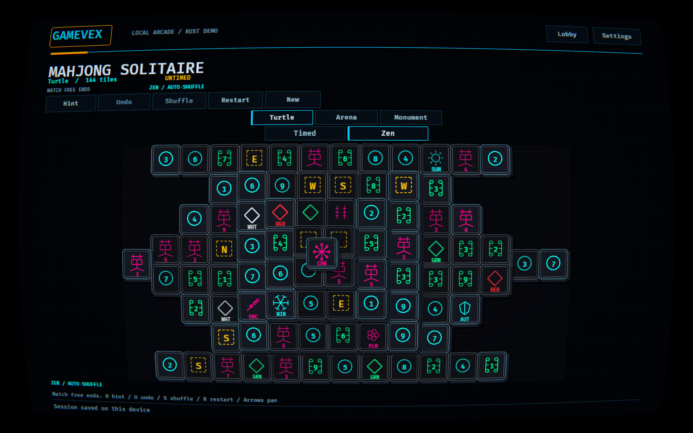

## Mahjong Zen mode and tile artwork — 30 October 2026

Zen mode is now available beside Timed. It starts an untimed deal, automatically shuffles remaining faces when a legal match leaves no moves, and excludes the run from best times. Switching modes preserves the current board until replacement is confirmed. Restart and new layout keep the chosen mode. Saves without the added mode metadata default to Timed.

Automatic shuffles preserve Undo through bounded face snapshots (four shuffle boundaries, at most 80 pair entries); after repeated shuffles the oldest prefix is dropped together. Undo restores the exact pre-shuffle faces and removed pair after reload. Manual Shuffle keeps its earlier assistance/history-reset semantics. Additional core tests exercise real automatic shuffles, five-shuffle history truncation, malformed snapshots, and invalid changes to previously removed tiles. Application tests cover mode staging/cancel/confirmation, cabinet isolation, restart/layout mode retention, and Zen record exclusion.

Tiles now follow the original web cabinet: square graphite faces, rounded rims, visible side/bottom bevels, neon ring-and-rank dots, bamboo stalks, a hand-drawn character mark, dashed wind frames, colored dragon diamonds, and distinct flower/season symbols. Selection is pink, hints are gold, and blocked tiles are muted. Graphics and hit targets use the same layer projection and board clip. Label occlusion checks the actual text bounds so unrelated overlapping corners do not hide visible ranks. Two regressions cover that case and a true text overlap. Phone tiles remain at least 40 logical pixels; desktop fitting may use 32-pixel faces.

The updated suite has 151 Rust tests and 31 browser cases. Browser additions exercise mouse/touch Zen selection, an untimed clock over a 600 ms observation, reload restoration, and canceled/confirmed mode changes. Actual Chrome checks confirmed Zen at a zero elapsed clock and the revised artwork at desktop and 390×844 phone sizes. Native checks confirmed mode selection and the same artwork. All checks and builds pass locally. The complete 31-case suite passed with Chromium/Metal, one worker, and retries disabled; physical phone, other-browser, and hosted-CI coverage remain separate.

## Solitaire family first pass — 30 October 2026

Klondike Draw 1/3, standard FreeCell, and Spider 1/2/4 suits share a table view with independent saved deals, bounded undo, hints, first-action foreground timers, per-mode unassisted best times, mode/redeal confirmation, and mouse drag or touch selection. Tables pan in both axes and preserve readable 48-pixel minimum card widths. Exposed cards display rank and suit without leaking covered central artwork through the separate text layer. Empty piles identify stock, waste, free cells, and Ace foundations. Save version 6 migrates existing Rust-demo games without replacing them.

TypeScript oracle fixtures cover stock/waste recycling, foundation return, FreeCell supermove capacity and empty-target exclusion, Spider mixed-suit placement versus suited-run movement, stock-deal ordering, empty-column rejection, and automatic completed-run extraction. The parity check found and corrected reversed Spider stock-row order. Every mode also has a complete save/load round-trip regression; validation accepts both Klondike draw modes and all three Spider suit counts. Each saved history snapshot is validated. A save containing sixteen history snapshots in each of the three new games measured 178,146 bytes, below the 256 KiB limit. Assistance remains set after Undo.

All 170 Rust tests, formatting, and strict workspace Clippy pass. Application tests cover replacement cancellation, game isolation, settings return/reset, responsive hit bounds, and FreeCell foundations. The browser suite now has 37 cases, adding stock/undo/reload, FreeCell hints, family/mode isolation, phone bounds/pan, mouse dragging, and actual touch card movement. All 37 browser cases pass locally on Chromium/Metal with one worker and retries disabled (55.2 seconds). Native release packaging and WASM packaging pass. Actual native checks rendered all three tables, dealt Klondike stock, moved FreeCell’s exposed 8 of Clubs to a free cell (persisted moves=1), and dealt Spider’s stock row (stock=40, moves=1). Chrome checks rendered all families, exercised stock input, restored Spider 2 suits after reload, and inspected a 390×740 viewport. QA used isolated native and browser saves. No hosted CI or physical-phone pass is claimed for this branch. Relaxed FreeCell, automatic finish, richer card transitions, physical-device testing, and shared ticket/shop progression remain follow-up work.

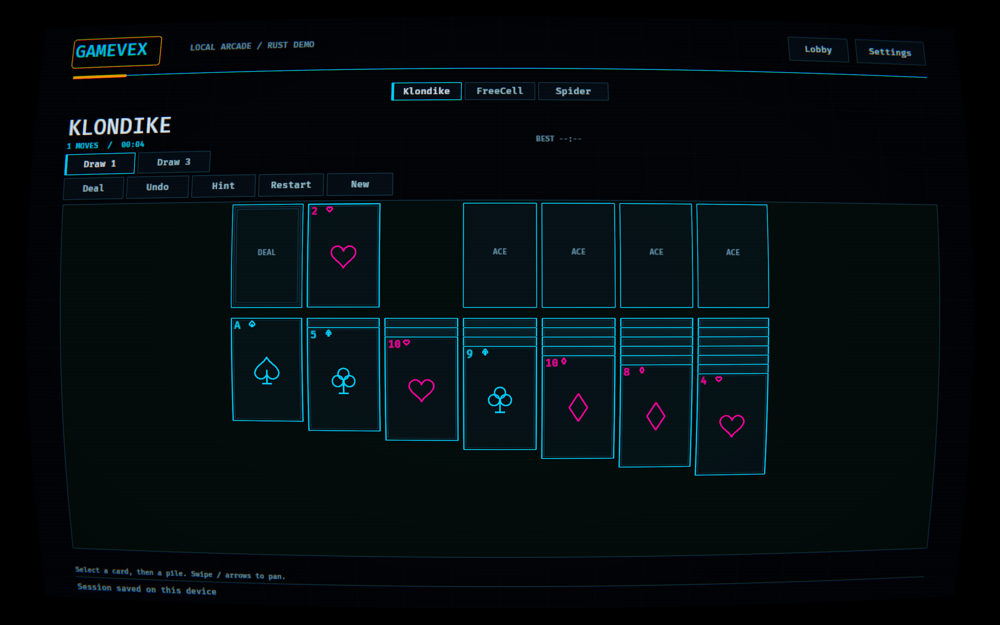

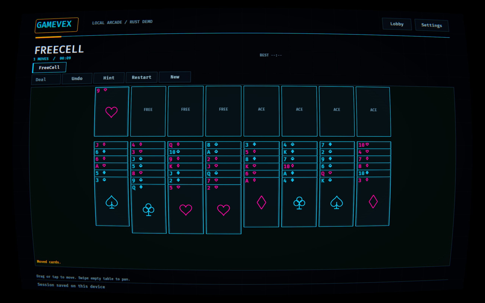

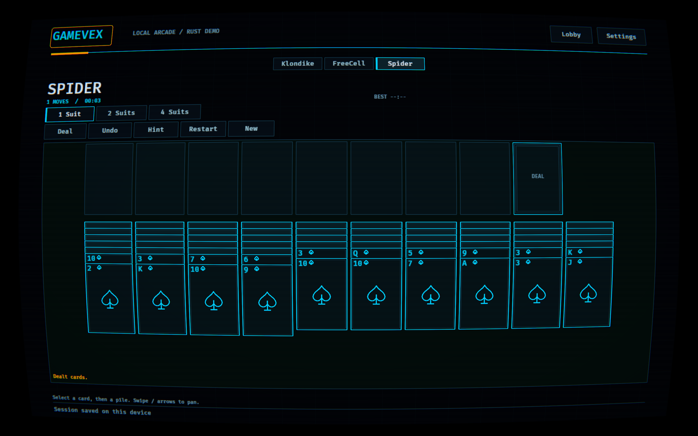

## PR #3 browser regression repair — 30 October 2026

The push run 41069194414 and PR run 41070624930 each passed 36 browser cases and failed only FreeCell hint selection, including its retry. The test clicked Hint but polled a variant that was already FreeCell before the click. It then read a null selection before the slow software-rendered application frame consumed the pointer input.

The repaired test waits for the actual selection and the saved assistance flag before using the hinted card bounds. A second case deliberately delays application animation callbacks by 300 ms while leaving pointer input and DOM inspection responsive. The old assertion failed all three delayed-frame reproductions locally; the repaired normal and delayed cases passed all six repeated runs. The complete 38-case suite also passes locally with Chromium/Metal and retries disabled. No production behavior, timeout, or retry policy changed. Hosted verification of the pushed repair remains pending.

## Separate patience games and drag controls — 30 October 2026

Solitaire, FreeCell, and Spider now have separate lobby entries and retain their existing independent saves. Their shared navigation tabs are removed. The nine-game lobby uses a clipped roster with a proportional scroll indicator, mouse-wheel and touch scrolling, Page Up/Page Down, and automatic reveal when Tab focuses an offscreen game. Header and session footer stay fixed. Tests verify stable navigation order, visible hit clipping, and focus reveal at desktop and phone sizes.

Mouse and touch share a pending card press: crossing eight logical pixels starts a drag; releasing a tap uses selection, while a legal drop commits one move. Dragged cards lift from the table, legal destinations highlight, and the original grab point stays anchored even for clipped cards. Invalid drops, canceled touches, focus loss, resizing, and navigation cancel the drag without moving cards. Empty table swipes still pan. Core rules determine which stacks can be picked up.

All 175 Rust tests and strict Clippy pass; native release packaging and WASM packaging succeed. All 42 browser regressions pass locally on Chromium/Metal with one worker and retries disabled (58.0 seconds), including phone touch dragging, active touch cancellation, invalid drops, lobby swiping, separate game navigation, and delayed-frame hint consumption. Actual native checks scrolled the lobby, opened FreeCell directly, and dragged a card into a free cell. Actual Chrome checks at 390×740 swiped the lobby to reveal all three entries, opened FreeCell by touch, and moved a card with touch input (moves increased from 1 to 2). Native and browser QA used isolated save namespaces. Physical-device and hosted-CI verification remain separate.

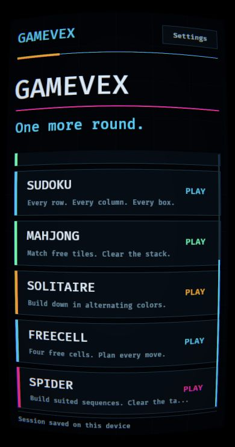

## Table visual and audio feedback — 30 October 2026

Solitaire, FreeCell, Spider, and Mahjong now share bounded transient presentation events: selection accents, green move trails and landing sparks, pair-removal outlines, red invalid-action pulses, undo/shuffle badges, gold hint/run accents, and win fountains. The most recent committed move removes stale action badges. Reduced motion renders stationary accents and labels; all effects stay within table bounds, expire, and clear on navigation or focus loss. Winning, undoing a win, and reopening saved games have application regression coverage. The events are not serialized and do not block input or change rules.

Eleven new deterministic PCM cues distinguish card picks/moves/deals, woody tile picks and pair matches, undo, hints, shuffle, invalid actions, completed runs, and wins. Table actions use these cues without the old extra button bleep. Audio uses the existing gesture-unlocked browser context/native Bevy playback, shared mute/volume, bounded cache, four-voice cap, and prioritized win cues. New tests verify gesture gating, immediate mute, zero volume, drained cues not replaying after unmute, and bounded event queues/expiry. All 180 Rust tests, formatting, strict Clippy, native release packaging, and WASM release packaging pass. All 43 browser regressions pass locally with Chromium/Metal, one worker, and retries disabled (1.1 minutes). Actual browser checks confirmed match sparks and TileMatch playback, plus muted hints with an unchanged playback count and zero voices. Reduced-motion hints rendered stationary accents. These local checks do not establish hosted CI or physical-device results. All 27 synthesized cues pass WAV-format, headroom, deterministic waveform, quiet-tail, and distinctness checks. The preview contains Move, Tile match, Undo, Hint, Run, and Win.

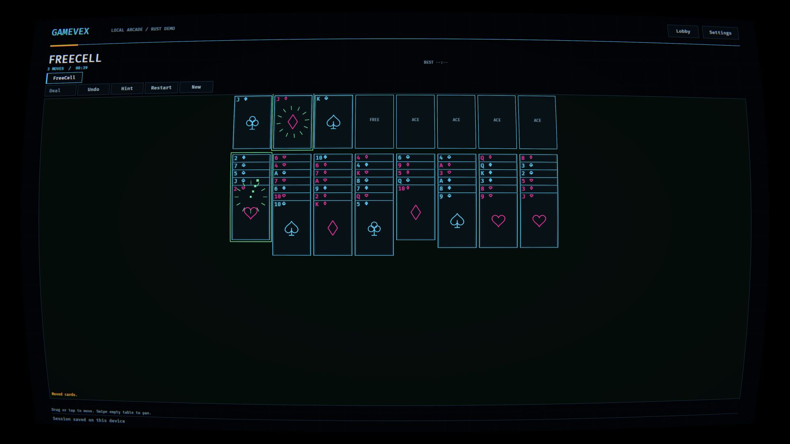

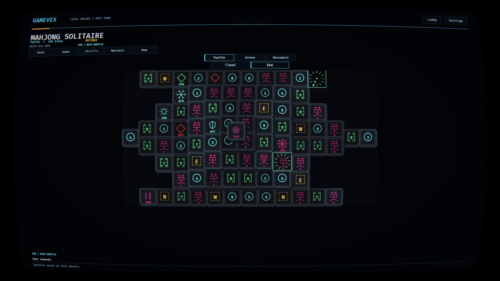

[Table sound preview](audio/table-preview.wav)

## Main CI repair and audio parity — 30 October 2026

[Run 41110546224](https://github.com/Tasty-Kiwi/gamevex-2/actions/runs/41110546224) passed macOS validation and deployment, but its browser job failed four cases. Both table feedback cases saw Undo age at only 0.3 seconds after a 5-second expiration wait: `TableFeedback::tick` discarded elapsed time above 0.1 seconds per frame. The software renderer therefore stretched short effects over many seconds. Feedback now ages using the actual finite, nonnegative delta and expires after a stalled frame. Separate focused 1,200 ms-frame regressions for Mahjong and FreeCell both failed against the previous WASM and pass against the repair. The other failures were the 45-second budgets for compound cabinet navigation and two consecutive touch drags with restart/confirmation between them; these scenarios are split into independently initialized tests with the same interaction/save assertions. Test timeouts and retry policy are unchanged. CDP teardown preserves the original error when a timed-out test has already closed its page.

Native playback previously linearly interpolated PCM16 through rodio, while browser playback handed 22,050 Hz cue buffers to Web Audio's resampler. Web playback now interpolates in the same integer sample domain and creates buffers at the AudioContext sample rate. The existing cue bytes, gain, volume/mute, voice limit, and cache limit remain. Host tests compare every sample against Bevy AudioSource decoding and rodio 0.20.1 UniformSourceIterator for all 27 cues plus 160/440/650/1040 Hz tones at 22,050, 44,100, and 48,000 Hz. Browser tests intercept the actual mono AudioBuffers for a button click and compare lengths and full sample fingerprints with the native reference at 44,100 and 48,000 Hz; both pass. The fixture is tests/fixtures/native-button-beep.json and was generated from crate::tone(440) through the native decoder/interpolator. The silent stereo stream maintained by Bevy is excluded from that test capture. This establishes software-buffer parity, not a hardware loopback comparison.

All 182 Rust tests, strict Clippy, formatting, and the WASM release build pass locally. The complete 52-case browser suite passes with Chromium/Metal, one worker, and retries disabled (1.2 minutes). The two slow-frame expiry tests also pass all six repetitions. Restart confirmation remains covered in its own short test. Hosted verification of these local changes still requires a new push/run.

## Screenshots

Actual native render captures, excluding window chrome.

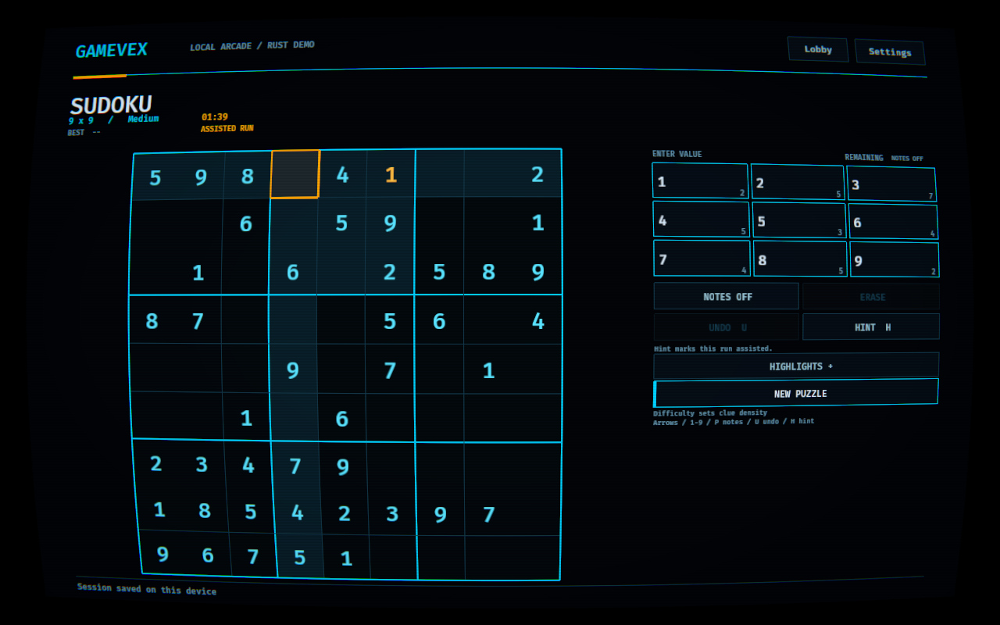

Earlier Sudoku port capture:

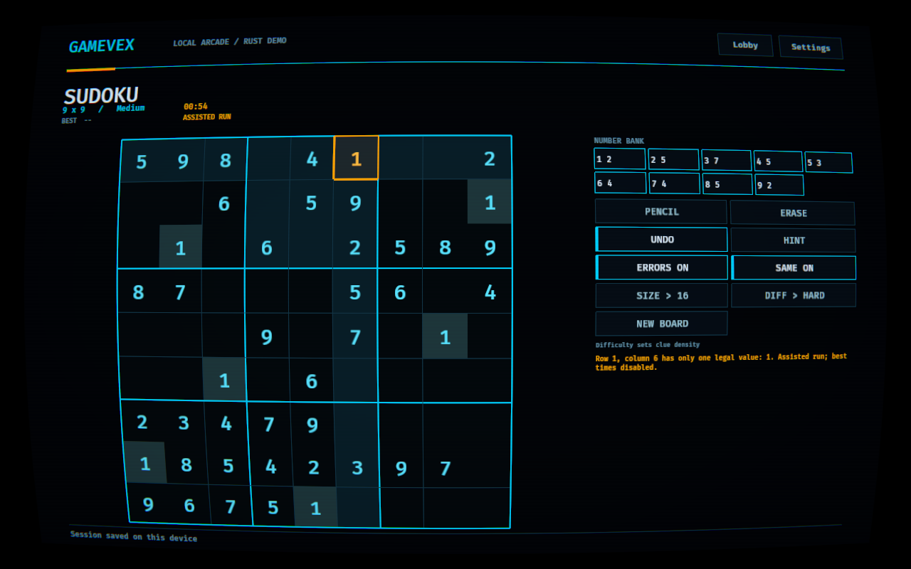

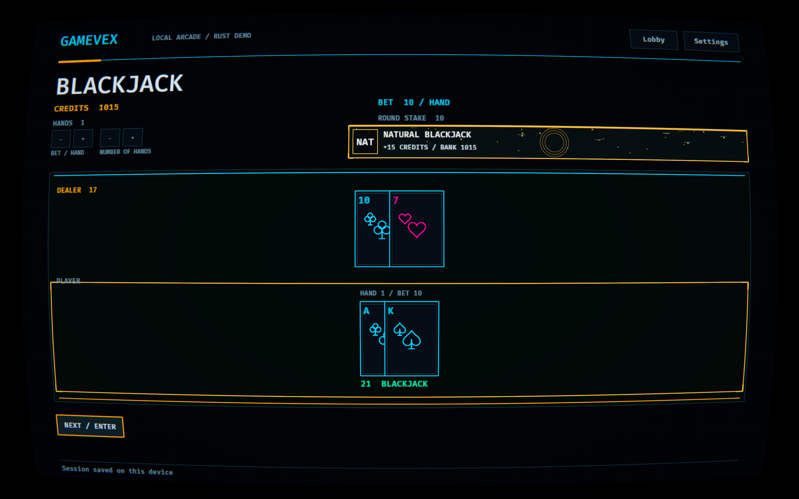

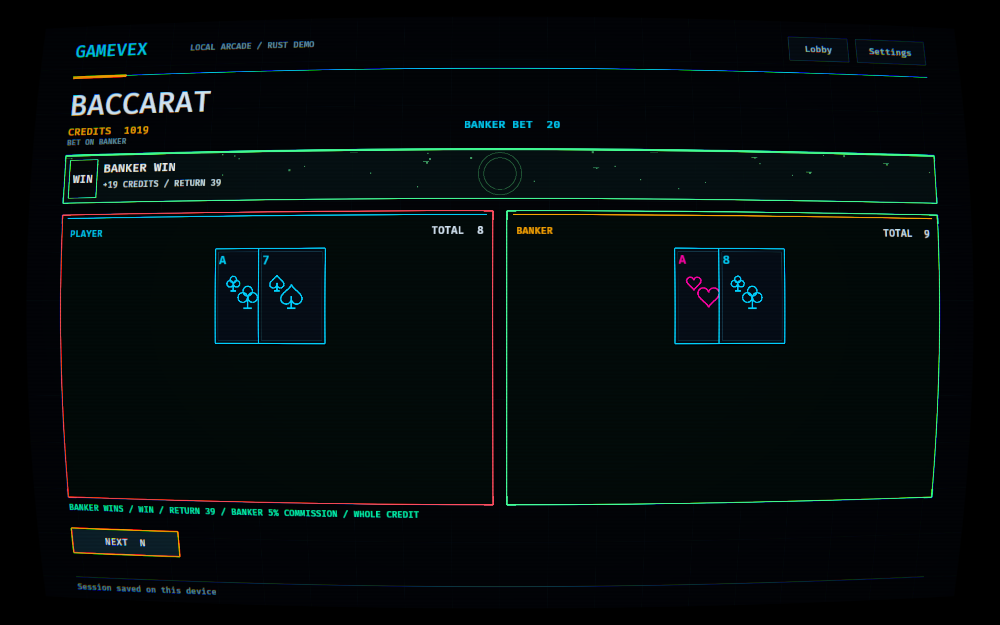

 The interaction repair capture shows the shared Card Lab after a secondary flip:

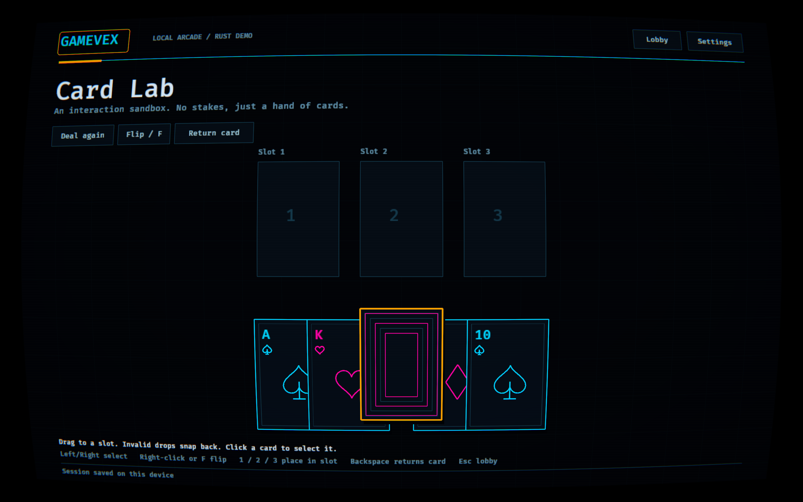

Earlier captures follow. The first shows chromatic aberration at its default 35%; the next two show the earlier monitor update, followed by the initial demo:

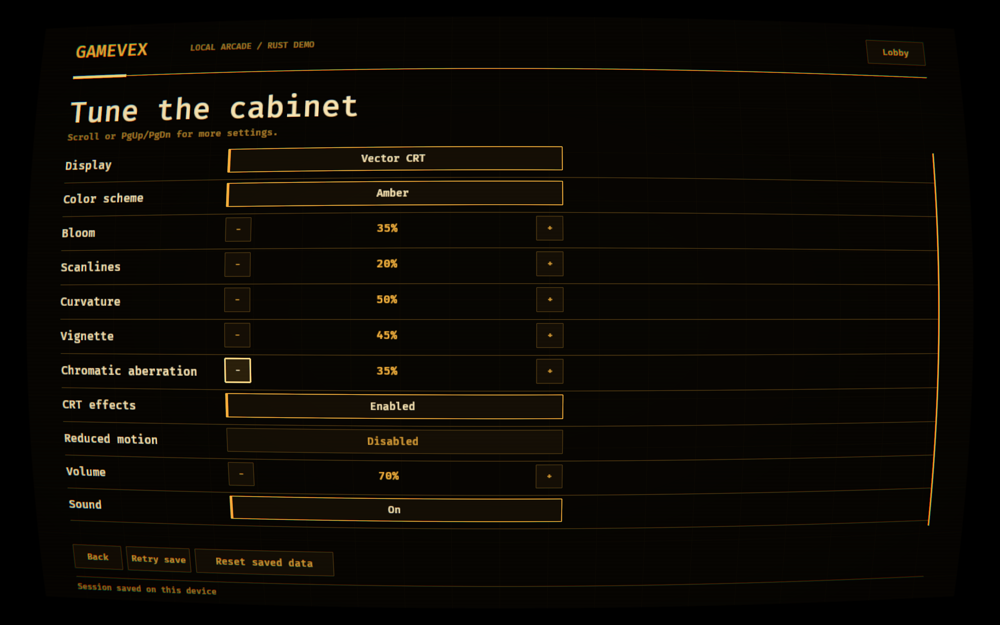

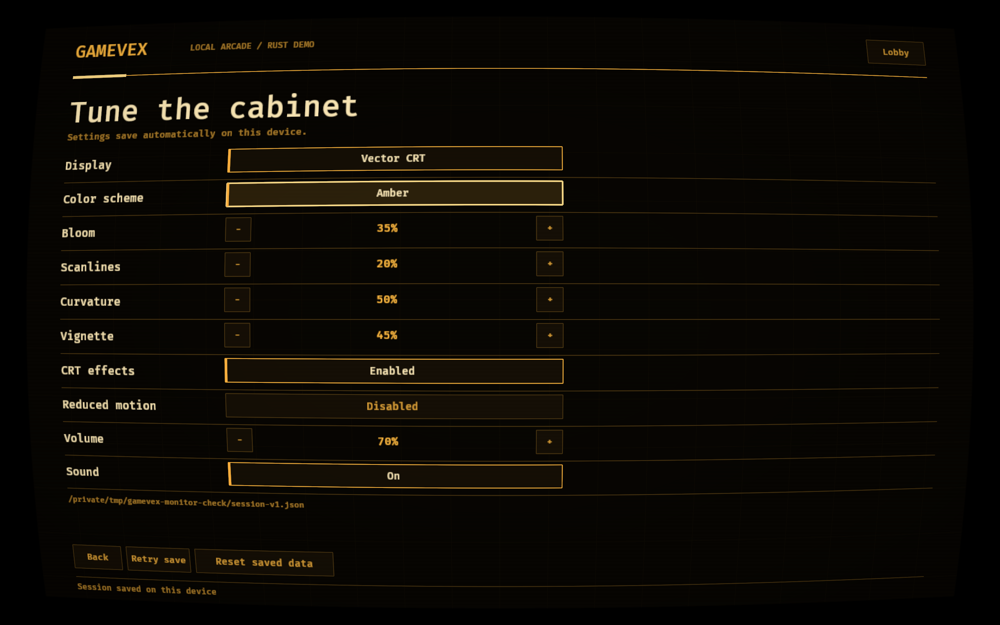

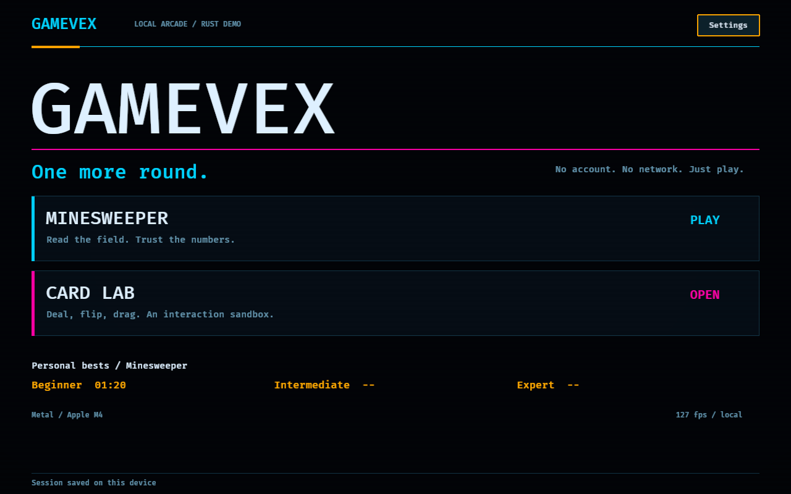

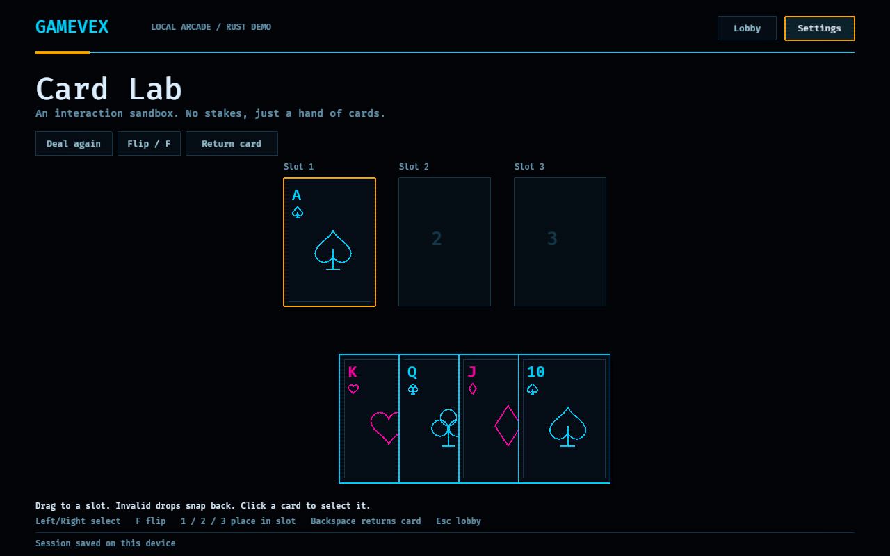

## Limits of this verification

No physical trackpad gesture, audible playback judgment, screen-reader audit, Safari/Firefox run, unavailable-WebGPU browser, long-duration soak, touch-only device, signed/notarized distribution, or other native operating system was verified. Browser focus/visibility handling is implemented with lifecycle snapshots and transition epochs, and clock behavior is tested headlessly; abrupt OS/process termination can still lose data since the last successful write. Card Lab focus loss cancels dragging in the model; resizing midway through a held native drag was not verified by the available automation. The canvas does not provide a full semantic accessibility tree for its virtual controls or board cells.
