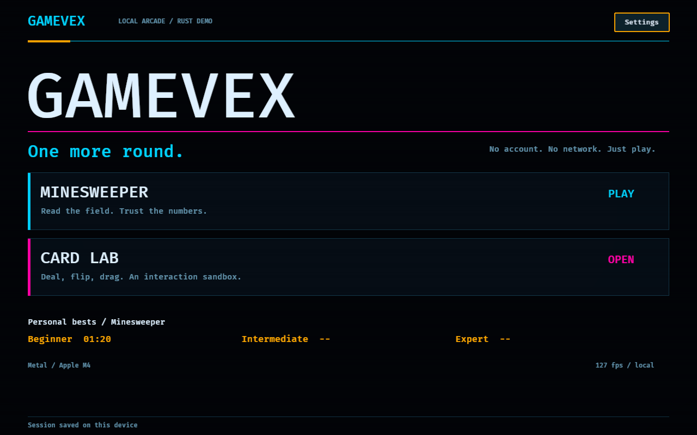
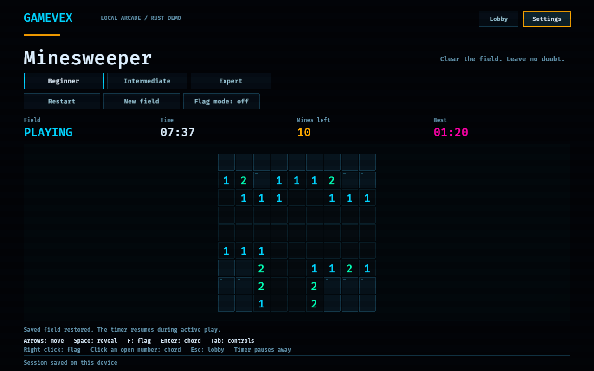
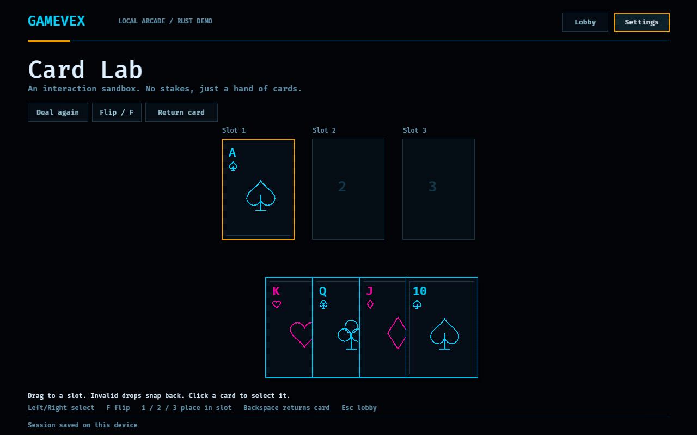

# GameVex Rust demo verification

Verified locally on 28 October 2026. All implementation and artifacts are under `gamevex-2/src`; the original GameVex repository was used only as a read-only rules/palette reference. Focused implementation and review work used Luna subagents.

## Automated checks and builds

- `cargo fmt --all -- --check`
- `cargo test --workspace --locked`: 25 tests passed (19 core, 6 application/platform).
- `cargo clippy --workspace --all-targets --locked -- -D warnings`
- Native development and release builds succeeded; `scripts/package-macos.sh` produced `target/GameVex Rust.app`.
- WASM release compilation and wasm-bindgen packaging succeeded; the generated JavaScript passed `node --check`.
- Shell scripts passed `bash -n`; the custom browser loader passed `node --check`.

Tests cover first-reveal protection over every difficulty and 32 seeds, mine/adjacency counts, flood behavior and pre-existing flags, correct/wrong-flag chording, win/loss and completed-command rejection, zero-seed determinism, save round trips and invalid-state checks, bounded elapsed time, record improvement, repeatable cards, valid/invalid/occupied drops, drag cancellation, native atomic file replacement, board picking with a clipped/panned viewport, modal focus restoration, and timer transition/fractional-millisecond accounting.

Dependencies are locked in `Cargo.lock`: Bevy 0.17.3, serde 1.0.228, serde_json 1.0.145, wasm-bindgen 0.2.129, and web-sys 0.3.106. The machine uses Homebrew Rust/Cargo 1.99.1. Because that distribution lacked a WASM target library and linker, the browser build used its installed Rust sources through `build-std`, plus an official Rust LLD extracted into `/private/tmp` and a matching temporary wasm-bindgen CLI. No global Rust toolchain was replaced. The regular rustup-target path is also documented in the README.

The transitive macOS dependency `block 0.1.6` emits Cargo's future-incompatibility notice. Workspace Clippy itself has no warnings.

## Actual runtime checks

| Check | Native macOS | Browser WebGPU |
| --- | --- | --- |
| Shared lobby, Minesweeper, Card Lab, settings render | Exercised | Exercised |
| Actual backend | Metal / Apple M4 | BrowserWebGpu; browser withheld adapter name |
| First reveal and flood | Exercised | Exercised |
| Complete a game and update a record | Exercised | Exercised |
| Mine-hit loss | Exercised | Exercised |
| Secondary-click flag / successful and wrong-flag chord | Exercised | Exercised through board input; wrong-flag chord lost and retained the earlier correct flag on reload |
| Keyboard cell focus, reveal/flag, toolbar/dialog navigation | Exercised | Exercised |
| Save and restore | Process restarted; active field/time/record/settings restored | Reload/navigation restored board, flag, time, record and preset |
| Timer outside the game | Exercised through screen/focus changes | Settings pause: exactly 30,232 ms before and after an extended pause |
| Card selection / flip / keyboard slots | Exercised | Exercised |
| Pointer valid / occupied-slot drops and snapback | Native automation drag gesture did not reliably deliver motion; not claimed | Exercised, including card stacking and flip after invalid drop |
| Resize / narrow Expert board | Resizable native window rendered at 2× DPI | 390×844 CSS pixels; 32-pixel cells, clipped viewport, keyboard pan to column 30 and flag confirmed in state |
| Display presets | Vector CRT and Pixel CRT exercised | Preset persisted; geometry uses reduced resolution, text remains readable |
| Corrupt save recovery | Validation and file operations tested headlessly | Isolated invalid JSON preserved until explicit Settings reset; modal confirmed by keyboard |
| Storage failure | Error paths exist; actual native permission denial not exercised | Injected adapter failure kept the field playable with a persistent in-memory warning |

Browser fault tests use the documented isolated `gamevex.rust-demo.qa.v1` namespace. The unavailable-storage case is deliberate adapter fault injection, not a claim that browser permissions or quota were denied. Runtime inspection uses opt-in DOM diagnostics; it does not alter the authoritative game model.

## Measured performance

Hardware: MacBook Air, Apple M4 with 10 CPU / 10 GPU cores, 16 GB RAM. Native backend: Metal, actual adapter `Apple M4`. All samples use a 1280×800 logical window and 300 foreground gameplay frame intervals. The earlier development run reported 2× DPI (2560×1600 backing pixels); the final release run reported 1× DPI (1280×800 backing pixels). Bloom was 0.35, bypassed with CRT off. These are short frame-interval samples, not GPU-only timings or a sustained soak.

| Build / DPI | CRT | Mean interval | p95 interval | Mean FPS |
| --- | --- | --- | --- | --- |
| Development / 2× | Enabled | 16.67 ms | 18.28 ms | 60.0 |
| Development / 2× | Disabled | 16.66 ms | 20.10 ms | 60.0 |
| Final release / 1× | Disabled | 16.67 ms | 19.27 ms | 60.0 |
| Final release / 1×, after build finished | Enabled | 16.67 ms | 29.86 ms | 60.0 |
| Final release / 1×, WASM compiler active | Enabled | 20.56 ms | 54.61 ms | 48.6 |

Unloaded samples reached the 60-FPS mean target on this machine. The compiler-load sample and p95 values show frame jitter; these measurements do not establish a sustained frame-time guarantee or isolate the effects' GPU cost. Browser lobby/gameplay displayed approximately 60 FPS; no equivalent browser frame-profile or cross-hardware benchmark is claimed. The final packaged native release was launched successfully on Metal.

## Browser startup and payload

The loader visibly checks WebGPU support, imports the module, and shows initialization errors. Local warm-cache initialization-to-canvas-ready markers measured **698.1 ms** and **644.0 ms** on two observed runs. This marker is emitted before first-pixel completion and is not a cold-start, network, or time-to-interactive guarantee. The local Python server sent an uncompressed WASM body; compressed file sizes are measured separately below. Embedded font/shader data are included in WASM; there are no required external media assets.

Final payload sizes are recorded in `build-sizes.json` after the last package build.

| File | Raw bytes | Gzip level 9 bytes |
| --- | ---: | ---: |
| WASM | 37,672,271 | 6,099,078 |
| Generated JavaScript | 107,369 | 17,327 |

 Gzip uses level 9 with deterministic headers. The development server does not negotiate those compressed files automatically.

## Screenshots

Actual native render captures, excluding window chrome:

## Limits of this verification

No physical trackpad gesture, audible playback judgment, screen-reader audit, Safari/Firefox run, unavailable-WebGPU browser, long-duration soak, touch-only device, signed/notarized distribution, or other native operating system was verified. Browser focus/visibility handling is implemented with lifecycle snapshots and transition epochs, and clock behavior is tested headlessly; abrupt OS/process termination can still lose data since the last successful write. Card Lab focus loss cancels dragging in the model; resizing midway through a held native drag was not verified by the available automation. The canvas does not provide a full semantic accessibility tree for its virtual controls or board cells.
